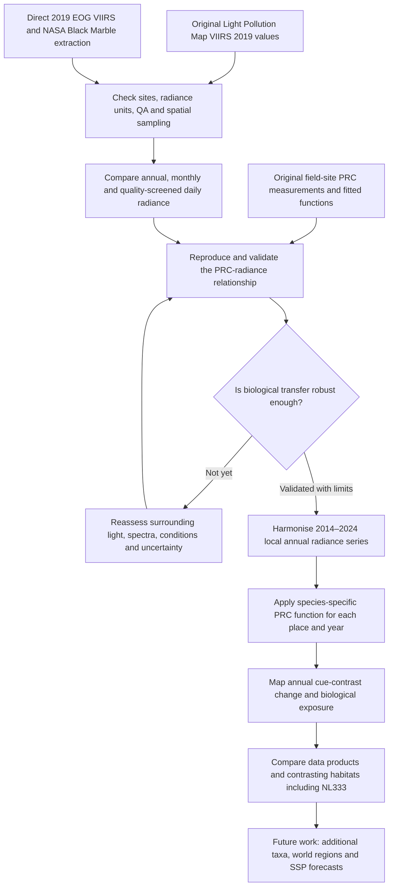

# Historical polarization-cue visibility — proposed analysis pipeline

**Decision:** 16 October 2026. **Status:** research plan only; site-data validation and European mapping have not been run.
**Working geography:** Europe, 2014–2024, with local radiance analysis at approximately 500 m–1 km.
**Branch:** a new research branch is proposed for Monday 19 October; not yet created.

## Pipeline overview

## Stage 1: reproduce the original site-level calibration

The original PRC-site predictor was explicitly confirmed to be the **VIIRS 2019 radiance layer** (`viirs_2019`) on lightpollutionmap.info, **not** its modelled sky-brightness layer. The website's present product version may differ from the one used during the original analysis.

Obtain the original site coordinates, field observation dates and times, published 2019 VIIRS values, raw PRC observations and species, measurement uncertainty, and fitted functions. Compare the **same site** against directly extracted 2019 EOG Annual VNL radiance and 2019 NASA Black Marble VNP46A4 snow-free annual radiance, tracking native grid, QA, valid-observation counts, instrument version, radiance units and spatial footprint.

Reproduce the published fit unchanged first. Then compare physically specified pixel and local-neighbourhood predictors, using site-level validation rather than choosing a buffer simply for the best fit. Artificial skyglow can arise from sources beyond the containing VIIRS pixel.

## Stage 2: choose biologically meaningful time support

| Radiance measure | Planned purpose | Limitation |
|---|---|---|
| **2019 annual** | Exact published-layer benchmark | May not represent the experimental date or hour |
| **Monthly / active-season** | Primary alternative matched to field dates | Weather, season and sparse valid observations |
| **Daily, quality screened** | Targeted tests of specific field dates and short-term variability | Overpass timing; gaps and interpolated daily estimates |

Evaluate variability at each original site and whether any alternative improves held-out PRC prediction. Keep processing-product choice separate from averaging-period choice.

For the European retrospective maps, **annual** 2014–2024 composites remain the initial candidate, with a pilot comparison of `f(annual radiance)` against averaged monthly `f(monthly radiance)`. Because PRC is nonlinear, those two are not generally equal.

## Stage 3: construct the historical 2014–2024 radiance fields

Compare EOG Annual VNL V2.2 and NASA Black Marble annual snow-free composites across all 11 years. Their radiance processing is different, but they rely on related VIIRS measurements; this is **not independent sensor replication**. Audit temporal instrument changes, 2017+ EOG pixel calibration, the 2021 snow anomaly, available quality indicators and gaps.

**Critical constraint:** the existing 2021 surface correction was estimated for annual *NUTS3 aggregates*. Do not treat it as a validated, spatially uniform adjustment for 500 m pixels. Develop pixel-scale 2021 handling and quantify the resulting uncertainty.

## Stage 4: calculate local PRC and map historical change

After validating the source radiance–PRC relationship, apply a species-appropriate function at each valid local observation in each year. Propagate radiance and transfer-function uncertainty; map continuous PRC and its change before aggregating to habitat area, NUTS3, countries and Europe. Nonlinearity means `mean(f(R_pixel))` generally differs from `f(mean(R_pixel))`.

Evaluate substantial versus biologically consequential radiance changes, including extremely bright NL333 / Westland and dark/intermediate-radiance sites. Report *continuous receptor contrast* separately from behavioural cue detectability; the latter requires independently supported thresholds.

## Stage 5: limitations and extensions

Explicitly assess blue/LED spectral under-response of VIIRS, non-local atmospheric skyglow, variation in cloud/aerosol and emission geometry, receptor spectral/polarization properties, and behavioural thresholds. Do not assume one species' fitted response generalises globally. Broader taxa/geography and SSP projections remain **subsequent research**, not prerequisites for the historical study.

## Restart instructions

Begin with the original field-site PRC table and fitted function. Do not code a Europe-wide PRC mapper before the site-level predictor is reproduced and evaluated. Do not create the new branch until Monday as agreed.

See [`lab_notebook/2026-10-16.md`](lab_notebook/2026-10-16.md) for the preceding VIIRS and density analyses, scientific reasoning, figure names and data provenance.

## Decision update — 19 October 2026: calibrated 2018 annual site predictor

**After completing the first 14-site comparison, the investigator chose the project's own corrected EOG 2018 annual VIIRS pixel radiance as the primary predictor for the next PRC site-function analysis.** The original `viirs_2019` website layer and corrected 2019 annual EOG values remain provenance/sensitivity comparators. The original website values exhibit high agreement at the level of the overall site-brightness gradient, notwithstanding processing and spatial-smoothing differences. Short-term natural variability and website smoothing are potential explanations; they are not yet quantitatively decomposed.

**Year mismatch:** 11 of 14 field sites were recorded in 2019 and three in 2018. Preserve and disclose this. Later evaluate year-matched and observation-month radiance as robustness tests, not preconditions for the first fit.

**Actual input files audited:** existing local EOG annual VNL **V2.1** `average_masked` for 2018 and 2019; a number of earlier notes had described the EOG processing generally as V2.2. Confirm V2.1 product lineage and versions before methods write-up. The post-2017 pixel correction is applied before biological analysis.

**Status:** the baseline PRC fitting code and site PRC responses have not yet been supplied; no PRC fits recalculated. The 2014–2024 historical mapping objective remains unchanged. See [19 October lab notebook](lab_notebook/2026-10-19.md).
